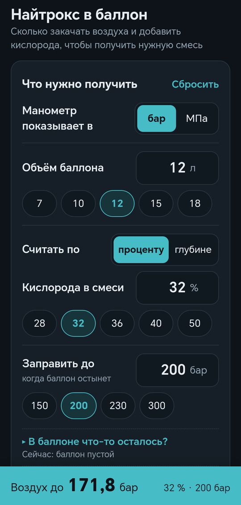

# Смесь в баллоне — калькулятор найтрокса

Android-приложение, которое подсказывает, сколько закачать воздуха и добавить кислорода,
чтобы получить в баллоне нужную найтроксовую смесь.



## Возможности

- расчёт по проценту кислорода или по глубине;
- учёт остатка газа в баллоне;
- давление в барах или МПа;
- работает без интернета, светлая и тёмная тема.

## Установка

Скачайте APK из раздела [Releases](../../releases) и откройте его на телефоне
(может понадобиться разрешить установку из неизвестных источников). Нужен Android 8.0 или новее.

## ⚠️ Безопасность

Приложение — вспомогательный инструмент. Оно не заменяет обучение работе с газовыми смесями
и кислородом. Всегда проверяйте полученную смесь газоанализатором и маркируйте баллон.
Автор не несёт ответственности за последствия использования расчётов.

## Сборка

Нужны JDK 17 и Android SDK (platform 35).

```sh
./gradlew assembleRelease
```

Калькулятор целиком находится в `app/src/main/assets/index.html` — это обычная HTML-страница,
её можно открыть и в браузере. Приложение показывает её через WebView.

Для подписанной сборки создайте `keystore.properties` в корне проекта:

```properties
storeFile=../your-release.jks
storePassword=...
keyAlias=...
keyPassword=...
```

Без этого файла собирается неподписанный APK.

## Лицензия

[MIT](LICENSE)
