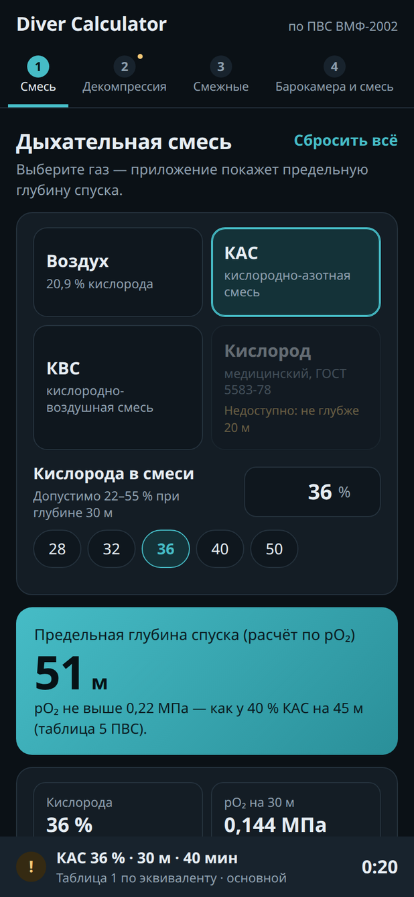
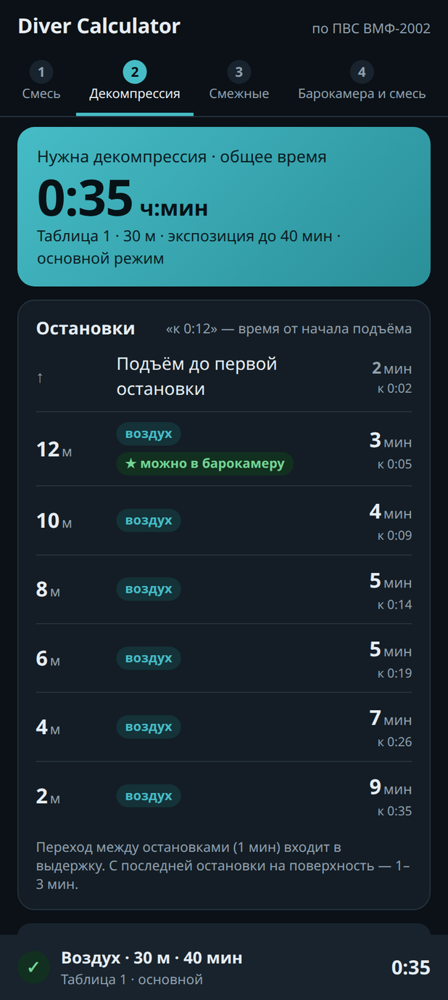
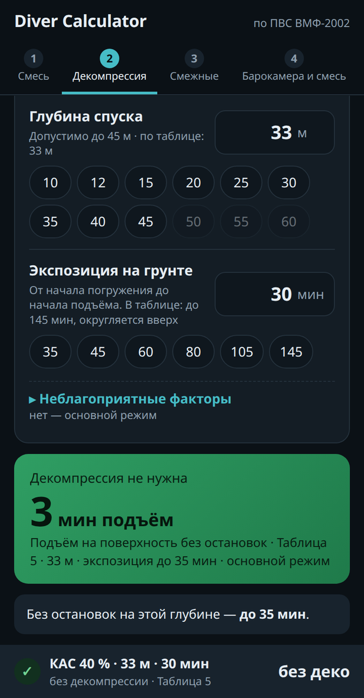
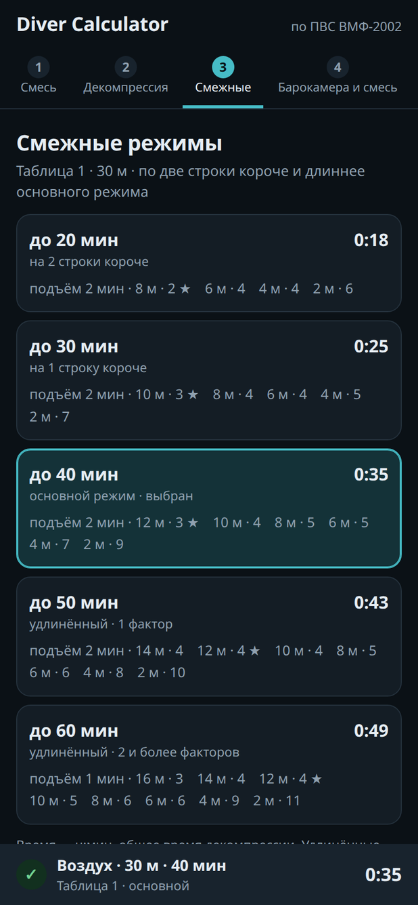
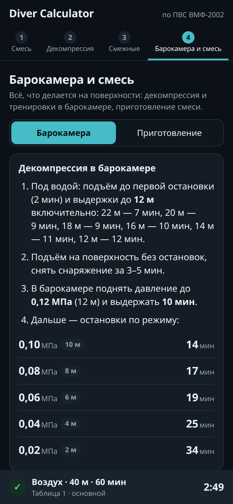
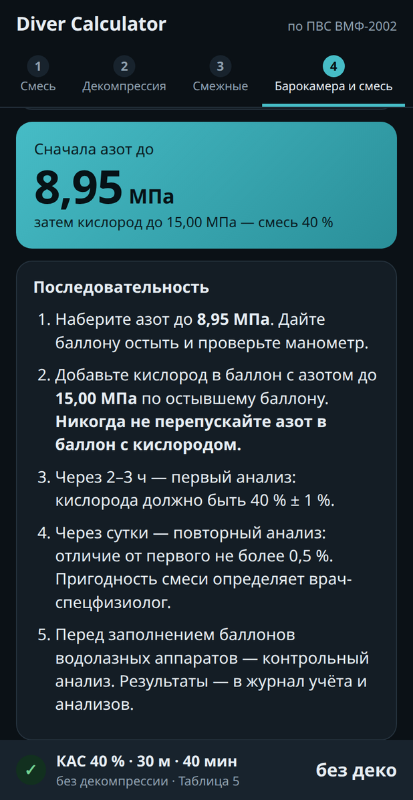

<div align="center">

# 🤿 Diver Calculator

**Калькулятор водолаза по Правилам водолазной службы ВМФ (ПВС ВМФ-2002)**

Дыхательная смесь и предельная глубина · режимы декомпрессии (и когда она не нужна) ·
смежные режимы · барокамера · приготовление смеси — в одном офлайн-приложении для Android.

[](https://github.com/KitWhite/diver-calculator/releases/latest)


[](LICENSE)

<br>

<table>
  <tr>
    <td align="center"><br><sub><b>Смесь</b></sub></td>
    <td align="center"><br><sub><b>Декомпрессия</b></sub></td>
    <td align="center"><br><sub><b>…или не нужна</b></sub></td>
    <td align="center"><br><sub><b>Смежные</b></sub></td>
    <td align="center"><br><sub><b>Барокамера</b></sub></td>
    <td align="center"><br><sub><b>Приготовление</b></sub></td>
  </tr>
</table>

</div>

> [!WARNING]
> Приложение — **вспомогательный инструмент**. Оно не заменяет водолазного специалиста,
> врача-спецфизиолога и печатное издание ПВС. Режим декомпрессии выбирается и утверждается
> в установленном порядке, смесь перед спуском **обязательно** проверяется газоанализатором.

---

## Содержание

- [Что умеет](#что-умеет)
- [Как пользоваться](#как-пользоваться)
- [Нюансы использования](#нюансы-использования)
- [Откуда данные](#откуда-данные)
- [Установка и обновление](#установка-и-обновление)
- [Для разработчиков](#для-разработчиков)

---

## Что умеет

| Вкладка | Что показывает |
|---|---|
| **1 · Смесь** | Воздух, КАС, КВС или медицинский кислород; для КАС и КВС — процент O₂. Предельная глубина спуска и pO₂ на выбранной глубине. |
| **2 · Декомпрессия** | Нужна ли декомпрессия для выбранной смеси, глубины и экспозиции. Если не нужна — так и написано, с временем подъёма и пределом «без остановок». Если нужна — остановки с временем от начала подъёма и общее время. Условия: рабочий, повторный, аварийный спуск, высокогорье; удлинённые режимы по неблагоприятным факторам. |
| **3 · Смежные** | По две строки таблицы короче и длиннее основного режима — видно, что будет при задержке на грунте, неблагоприятных факторах или пропуске остановок. |
| **4 · Барокамера и смесь** | Всё, что делается на поверхности: декомпрессия в барокамере для выбранного режима (с какой остановки поднимать, давление в камере, дальнейшие выдержки в МПа), тренировочные спуски 0,8–1 МПа, кислород в барокамере и пошаговое приготовление КАС/КВС. |

Все вкладки **связаны**: значения одной ограничивают выбор в остальных. Если допустимого режима
нет, приложение прямо пишет **«Спуск недопустим»** и объясняет почему.

## Как пользоваться

1. **Смесь.** Выберите газ; для КАС или КВС введите процент кислорода. Сразу видна предельная глубина.
2. **Декомпрессия.** Выберите условия спуска, введите глубину и экспозицию (или нажмите на
   готовые значения под полем). Неблагоприятные факторы — в свёрнутом списке под полями.
3. **Смежные** заполняются сами по уже введённым данным.
4. **Барокамера и смесь** — переключатель вверху: порядок декомпрессии в барокамере или
   приготовление смеси для выбранного процента.

Нижняя строка всегда показывает итог: смесь, глубину, экспозицию, таблицу и общее время
декомпрессии (или «без деко»). Зелёная галочка — всё в порядке, жёлтый «!» — есть пометки
(например, режим по эквиваленту), красный крестик — спуск недопустим. Нажатие на строку открывает
вкладку, где проблема. Кнопка **«Сбросить всё»** на первой вкладке возвращает значения по умолчанию.

---

## Нюансы использования

### Глубина и экспозиция

- **Округление — всегда в большую сторону**, как требует ПВС: 31 м считается по строке 32 м,
  экспозиция 41 мин — по столбцу 50 мин. Под полями видно, по какой строке таблицы идёт расчёт.
- **Экспозиция на грунте** — от начала погружения до начала подъёма (п. 3 приложения 4 ПВС),
  а не только «время работы на дне».
- Глубины **меньше 10 м** считаются по первой строке таблицы (10–12 м);
  для 40 % КАС глубины **меньше 21 м** — по строке 21 м.
- Если экспозиция больше табличной, режима нет — спуск недопустим. После **фактической**
  аварийной задержки на грунте выберите условия «Аварийный» (таблица 3).

### Неблагоприятные факторы и удлинённые режимы

- Факторы из п. 4 приложения 4: малотренированный водолаз, предрасположенность к декомпрессионной
  болезни, вода у поверхности ниже 10 °C, атмосферное давление ниже 745 мм рт. ст., тяжёлая работа.
- **Один фактор** — режим на строку ниже, **два и более** — на две строки ниже.
  Если такой строки в таблице нет, спуск недопустим: уменьшите экспозицию.
- Для кислорода вместо факторов — **характер работы**: тяжёлая работа сокращает допустимое время дыхания.

### Предельная глубина

| Газ | Предел | Основание |
|---|---|---|
| Воздух | 60 м | таблицы ПВС; глубже — только в исключительных случаях |
| 40 % КАС | 45 м | таблица 5 ПВС (21–45 м) |
| КАС / КВС другого процента | по pO₂ = 0,22 МПа, не глубже 60 м | расширение ПВС, см. ниже |
| Кислород | 20 м | допустимые сроки дыхания кислородом (pO₂ 0,3 МПа) |

### Декомпрессия — на той же смеси

- Режимы рассчитаны **для водолаза**: декомпрессия проходит **на той же смеси, что и спуск**.
  На воздухе — воздух, на 40 % КАС — 40 % КАС, на КАС 36 % — КАС 36 %.
- Если в режиме нет остановок, вкладка пишет крупно **«Декомпрессия не нужна»** и время подъёма.
  Ниже всегда указано, до скольких минут на этой глубине можно обойтись без декомпрессии,
  или что по ПВС таких режимов на этой глубине нет.
- По ПВС режимы **без остановок** есть только для 40 % КАС (таблица 5) — и для смесей богаче 40 %,
  которые считаются по ней эквивалентом (см. ниже). На воздухе даже самый короткий режим требует
  выдержки хотя бы на 2 м.
- У каждой остановки показано время от начала подъёма («к 0:12»). Переход между остановками
  (1 мин) входит в выдержку; с последней остановки на поверхность — 1–3 мин.

### КАС, КВС и смеси не 40 %

- **КАС и КВС** — по составу одно и то же (кислород + азот). Разница в приготовлении: КАС готовят
  на азоте (или на очищенном воздухе, если азота нет), КВС — на воздухе.
- В ПВС режимы есть **для воздуха и для 40 % КАС** (допуск ±1 %, т. е. 39–41 %). Для других
  процентов предельная глубина считается по **pO₂ = 0,22 МПа** (столько даёт 40 % КАС на 45 м),
  а режим декомпрессии — **по эквиваленту**, по парциальному давлению азота:

  | Смесь | Рабочий спуск | Повторный, аварийный, высокогорье |
  |---|---|---|
  | 22–38 % O₂ | таблица 1 по эквивалентной воздушной глубине | таблицы 2–4 по эквивалентной воздушной глубине |
  | 39–41 % O₂ | таблица 5 (есть в ПВС) | таблицы 2–4 по эквивалентной воздушной глубине |
  | 42 % O₂ и богаче | таблица 5 по эквивалентной глубине для 40 % КАС | таблицы 2–4 по эквивалентной воздушной глубине |

  Эквивалент всегда берётся к табличному газу, в котором кислорода **не больше**, чем в смеси
  водолаза: дыхание своей смесью на остановках не уменьшает запас. Пример: КАС 50 % на 30 м
  по азоту — как 40 % КАС на 23,3 м, поэтому режим берётся из таблицы 5 для 24 м.
- Такие режимы — **расширение за рамками ПВС**, приложение помечает их жёлтым предупреждением.

### Барокамера

- **★ можно в барокамеру** — после выдержки на этой остановке водолаза можно поднять для
  декомпрессии на поверхности. На вкладке 4 расписан весь порядок: какие остановки пройти под водой,
  подъём и снятие снаряжения за 3–5 мин, давление в камере (по глубине этой остановки, 10 м = 0,1 МПа)
  и выдержка 10 мин, затем остальные остановки в МПа.
- Если первая остановка 6 м и мельче, водолаза поднимают прямо с грунта, а в камере проводят
  режим без предварительной выдержки.
- Глубже 44 м декомпрессия в барокамере — только при экспозиции не более 20–25 мин.
  По аварийным режимам (таблица 3) она в ПВС не предусмотрена.
- Тренировочные спуски в барокамере на 0,8 и 1 МПа — таблица 6 (воздух). До 0,6 МПа в барокамере
  используются рабочие режимы (вкладка 2).
- Пропущены 1–2 остановки — немедленно (до 3 мин) погрузить на одну остановку глубже первой,
  выдержать 5 мин и продолжить по удлинённому режиму (вкладка 3).

### Повторные спуски

- Выберите интервал после окончания декомпрессии прошлого спуска: 30–119, 120–359 или 360+ мин.
- **Глубже 40 м** интервал должен быть не меньше 2 ч — вариант 30–119 мин недоступен.
- За 12 ч — не более 4 спусков до 20 м или 2 спусков до 60 м; к повторным спускам допускаются
  только устойчивые к декомпрессионной болезни водолазы после медосмотра.

### Кислород

- Таблиц декомпрессии для кислорода в ПВС нет — **декомпрессия не требуется**, ограничение одно:
  **допустимое время дыхания** по глубине и характеру работы (лёгкая и средняя или тяжёлая).
- Глубина округляется вверх до 5, 10, 15 или 20 м. Время дыхания кислородом в барокамере —
  на вкладке 4.

### Приготовление смеси

- **Кислород всегда добавляют в баллон с основным газом** — никогда не наоборот (приложение 13 ПВС).
  Пары масла в воздухе при перепуске в кислород взрывоопасны, поэтому для воздуха первым шагом
  идёт проверка на масло.
- Все давления — **по манометру остывшего баллона**. Расчёт учитывает атмосферное давление
  (манометр показывает избыточное), чистоту кислорода (медицинский — 99,5 %) и остаток в баллоне.
- Ограничения ПВС перед добавлением кислорода: азот — **не более 9 МПа**, воздух — **не более 11 МПа**.
  При превышении появится предупреждение — уменьшите давление готовой смеси.
- Раздел — на вкладке 4, «Приготовление». Процент берётся с вкладки 1.
- **«Основной газ уже в баллоне?»** — введите, что показывает манометр после закачки азота/воздуха,
  и приложение скажет, до какого давления добавлять кислород.
- Для 40 % на пустом баллоне показан и расчёт по **формуле ПВС** (`Ркисл = 0,67·Разота` или
  `0,33·Рвозд`). Она даёт чуть богаче смесь (около 40,1–40,6 %), но в пределах допуска 40 ± 1 %.
- Единицы давления — МПа, кгс/см² или бар; переключатель пересчитывает введённые значения.
- После приготовления — три анализа: через 2–3 ч (±1 %), через сутки (отличие не более 0,5 %)
  и перед заполнением баллонов аппаратов.

### Пометки ⚠ и опечатки ПВС

- **Общее время декомпрессии приложение считает само** — как «переход + все выдержки», а не
  берёт напечатанный итог.
- В электронной копии ПВС найдены опечатки. Однозначные **исправлены**, в спорных случаях принят
  **более длинный** вариант. Такие режимы помечены значком ⚠ с пояснением, что напечатано в ПВС.
  Полный список — в [`docs/pvs-errata.md`](docs/pvs-errata.md).

### Мелочи

- Всё работает **без интернета**; введённые значения сохраняются на телефоне.
- При нажатии на поле значение **выделяется целиком** — просто вводите новое число.
- Тема только тёмная.

---

## Откуда данные

- **ПВС ВМФ-2002**, приложение 4 (таблицы режимов декомпрессии 1–6), допустимые сроки дыхания
  кислородом и приложение 13 (приготовление 40 % КАС) — из электронной копии документа.
- Таблицы извлекаются скриптом [`tools/build_pvs.py`](tools/build_pvs.py) в
  `app/src/main/assets/pvs.js` — **977 режимов**. Скрипт сверяет каждый режим с напечатанными
  итогами и сам расставляет пометки о расхождениях.
- Найденные опечатки с расчётами — [`docs/pvs-errata.md`](docs/pvs-errata.md).
  Часть из них могла появиться при оцифровке — сверяйте с печатным изданием.

## Установка и обновление

1. На телефоне откройте [последний релиз](https://github.com/KitWhite/diver-calculator/releases/latest)
   и скачайте `.apk` из раздела **Assets**.
2. Откройте файл. Если Android спросит — разрешите установку из этого источника.
3. Новые версии ставятся **поверх** старой, настройки сохраняются.

Нужен Android 8.0 или новее.

## Для разработчиков

<details>
<summary><b>Сборка, структура проекта, обновление таблиц</b></summary>

<br>

Нужны JDK 17 и Android SDK (platform 35).

```sh
./gradlew assembleRelease
```

Для подписанной сборки положите в корень `keystore.properties` (в репозиторий не попадает):

```properties
storeFile=../your-release.jks
storePassword=...
keyAlias=...
keyPassword=...
```

```
app/src/main/
├── assets/
│   ├── index.html   — разметка и стили (интерфейс — обычная веб-страница)
│   ├── app.js       — расчёты, ограничения между вкладками, отрисовка
│   └── pvs.js       — таблицы ПВС (генерируется, не править вручную)
└── java/…/MainActivity.java — WebView-обёртка
tools/build_pvs.py   — извлечение таблиц из ПВС и проверка итогов
docs/pvs-errata.md   — найденные опечатки
```

Интерфейс можно открыть прямо в браузере: `app/src/main/assets/index.html`.

Пересобрать таблицы из документа ПВС:

```sh
soffice --headless --convert-to "html:HTML (StarWriter)" pvs.doc
soffice --headless --convert-to "txt:Text (encoded):UTF8" pvs.doc
python3 -I tools/build_pvs.py pvs.html pvs.txt app/src/main/assets/pvs.js
```

</details>

## Лицензия

[MIT](LICENSE)
